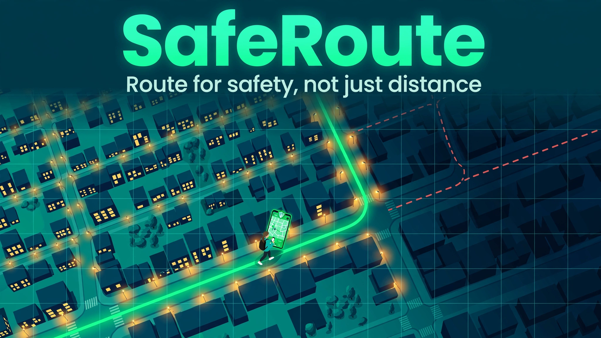
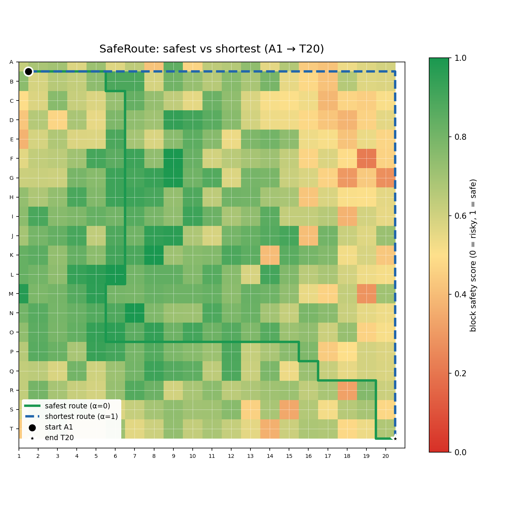
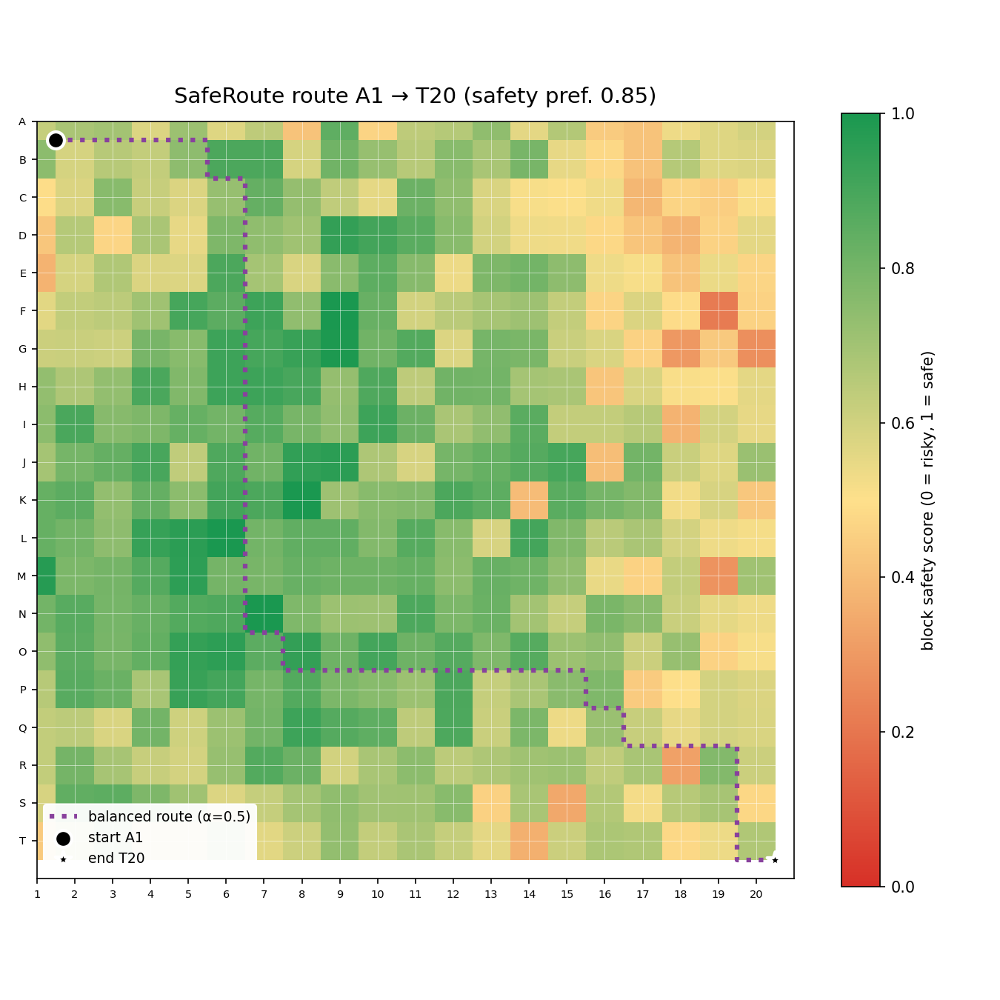

# 🛡️ SafeRoute

**Route for safety, not just distance.**

      



---

## The problem

Every maps app optimizes for one thing: **the shortest walk home**. But the
shortest walk home isn't always the safest — dark blocks, empty streets, and
areas with a history of incidents can turn a 10-minute shortcut into a risk,
especially for women and vulnerable pedestrians walking at night.

> Supports **UN SDG 5** (Gender Equality — safer streets for everyone,
> especially women) and **UN SDG 11** (Sustainable Cities — inclusive,
> resilient, safe human settlements).

## The solution

**SafeRoute** scores every city block for safety — street lighting, foot
traffic, and incident history — then routes with **A\*** using a cost model
that trades distance against danger:

```
cost(a → b) = α · distance(a, b) + (1 − α) · (1 − safety(a, b))
```

Slide α from **1 (shortest)** to **0 (safest)** and watch the route bend
around risky blocks. If something goes wrong, one **SOS** command fires a
contact cascade with live location sharing.

## Demo (runs out of the box)

```bash
pip install -r requirements.txt
python3 -m saferoute.cli demo
```

The bundled demo uses a fixed map (seed 49), routes A1 → T20 safety-first,
compares safest vs shortest, and simulates an SOS cascade. On the demo map:

| Route | Distance | Avg safety | Incident exposure |
|---|---|---|---|
| 🟢 Safest (α=0) | 40 blocks | **0.80** | 40 incidents |
| 🔵 Shortest (α=1) | 38 blocks | 0.57 | 64 incidents |

**2 extra blocks buys +0.23 safety and 24 fewer past incidents along the way.**

### CLI

```bash
# one route with a safety preference (0 = shortest … 1 = safest)
python3 -m saferoute.cli route --from A --to B --safety 0.8

# safest vs shortest, side by side (prints stats + saves a map)
python3 -m saferoute.cli compare --from A1 --to T20

# SOS contact cascade from your current block
python3 -m saferoute.cli sos --at J10
```

### Screenshots

Safety heatmap (red = risky, green = safe) with the computed routes overlaid:



A single safety-first route:



## Features

- 🗺️ **Grid-city model** — 20×20 blocks with per-block synthetic safety
  features (lighting, foot traffic, incident history); **seeded generation**
  makes every map reproducible.
- 🧭 **A\* pathfinding** with the safety-weighted cost model above and a
  user-facing safety↔distance tradeoff slider (`--safety 0 … 1`).
- ⚖️ **`compare`** — safest vs shortest side by side: distance, average
  safety, incident exposure.
- 🚨 **SOS simulation** — contact cascade in priority order with simulated
  acknowledgements, escalation to 911 if nobody responds, plus current
  location sharing.
- 📊 **Route map PNGs** — matplotlib safety heatmap with route overlay,
  generated for every command.
- 📦 **100% offline** — no API keys, no network, no accounts.

## Tech

- **Algorithm:** A\* with `h(n) = α · manhattan(n, goal)` — admissible
  because the safety term of every edge cost is non-negative, so A\*
  returns the provably optimal path for the chosen α.
- **Cost model:** `cost = α·distance + (1−α)·(1−safety)`, safety of an edge
  = mean of the two blocks' scores; block safety =
  `0.45·lighting + 0.35·foot_traffic + 0.20·(1 − incidents/5)`.
- **Stack:** Python 3, `numpy` (seeded city generation), `matplotlib`
  (route maps). That's it.
- **Tests:** 16 pytest tests — hand-verified A\* optimality on a tiny grid,
  a designed map proving α=0 vs α=1 chooses different paths, and SOS
  cascade ordering.

## Project structure

```
saferoute/
├── saferoute/
│   ├── __init__.py      # package version
│   ├── city.py          # GridCity: seeded safety-feature generation
│   ├── pathfinding.py   # A* + safety-weighted cost model + route stats
│   ├── sos.py           # SOS contact-cascade simulation
│   ├── viz.py           # matplotlib safety heatmap + route overlay
│   └── cli.py           # route / compare / sos / demo commands
├── tests/
│   ├── test_city.py        # seeded reproducibility, label parsing
│   ├── test_pathfinding.py # A* optimality on a hand-verifiable grid
│   ├── test_tradeoff.py    # α=0 vs α=1 picks different paths (designed map)
│   └── test_sos.py         # cascade order + acknowledgement behaviour
├── assets/
│   ├── hero.png         # hero banner
│   ├── compare.png      # safest-vs-shortest demo map
│   └── route.png        # safety-first route demo map
├── requirements.txt
├── LICENSE              # MIT
└── README.md
```

## Roadmap

- [ ] Real city data: ingest open street-lighting + crime datasets per city
- [ ] Time-of-day safety (a lit street at noon ≠ at midnight)
- [ ] Turn-by-turn web UI with a live α slider
- [ ] Crowd-sourced safety reports ("this block feels unsafe right now")
- [ ] Share-live-location mode during the walk, auto-SOS on deviation

---

MIT © 2026 Parth (872000). Built for safer streets. 🛡️
